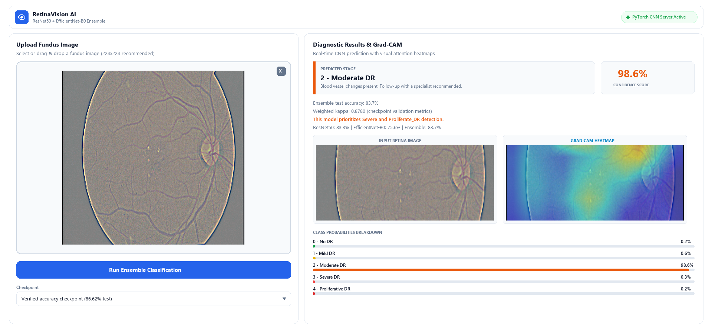
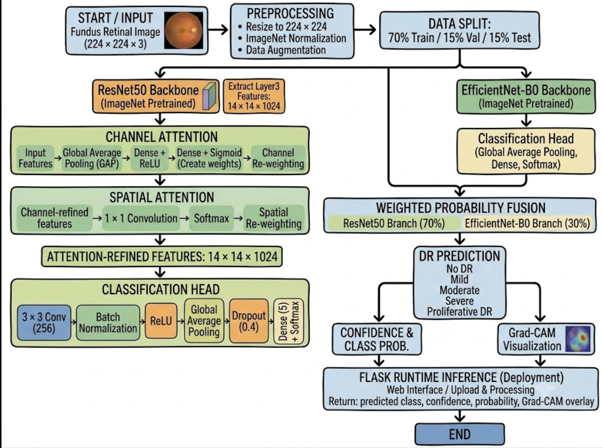
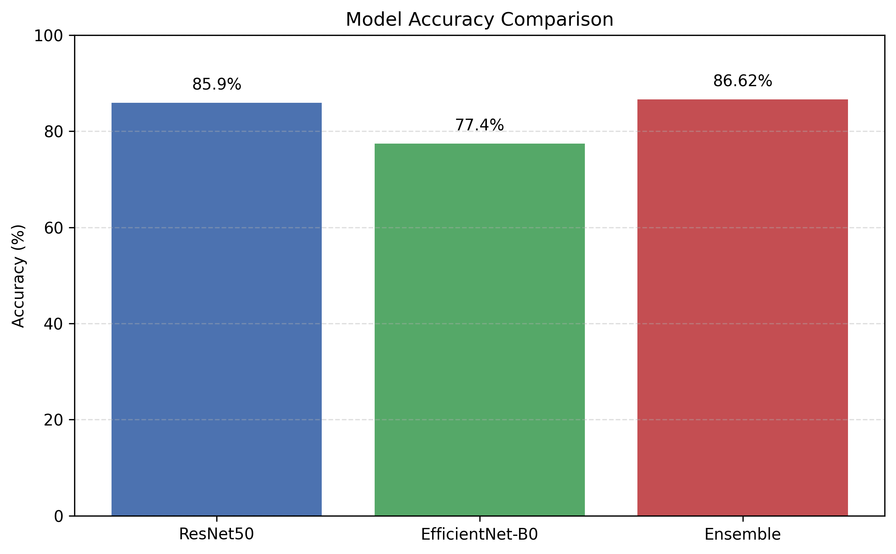
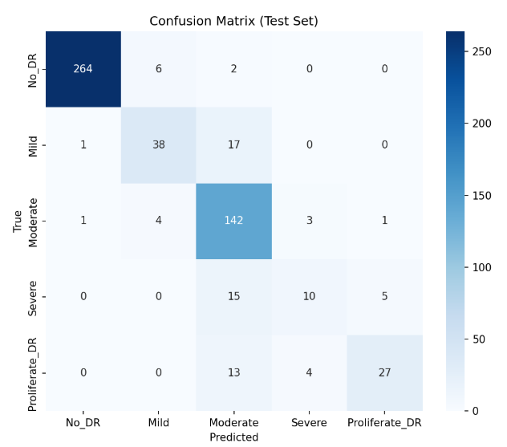
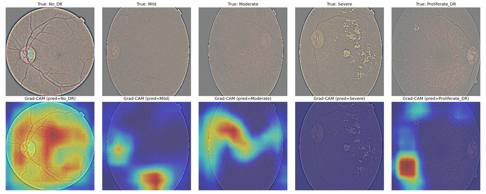

<div align="center">

# 👁️ RetinaVision AI
### Automated Diabetic Retinopathy Grading via Dual-Attention ResNet50 & EfficientNet-B0 Ensemble with Grad-CAM Explainability

[](https://www.python.org/)
[](https://pytorch.org/)
[](https://flask.palletsprojects.com/)
[](LICENSE)
[](https://www.kaggle.com/c/aptos2019-blindness-detection)
[](#-evaluation-results)
[](#-evaluation-results)

<p align="center">
  <b>An end-to-end clinical screening-support deep learning system featuring dual-backbone feature fusion, attention gating, focal loss optimization, and visual interpretability.</b>
</p>

[Key Features](#-key-features) •
[Web Interface](#-interactive-web-application) •
[Architecture](#-system-architecture) •
[Results](#-evaluation-results) •
[Quickstart](#-quickstart-guide) •
[Explainability](#-grad-cam-explainability) •
[Repository Structure](#-repository-structure)

---

</div>

<br>

<div align="center">
  
  <p><i>Figure 1: RetinaVision AI interactive clinical web interface showing real-time stage prediction (Moderate DR, 98.6% confidence), class probability distributions, and dual Grad-CAM attention heatmap overlay.</i></p>
</div>

<br>

## 📌 Overview

**Diabetic Retinopathy (DR)** is a microvascular complication of diabetes mellitus and a leading cause of preventable blindness among working-age adults globally. Timely detection through regular fundus screening is critical, yet manual grading by ophthalmologists is resource-intensive and subjective.

**RetinaVision AI** addresses these challenges through a production-ready, interpretable deep learning pipeline:
1. **Dual-Branch Architecture**: Combines a **ResNet50** backbone enhanced with sequential **Channel and Spatial Attention (CBAM)** alongside a complementary **EfficientNet-B0** branch.
2. **Confidence-Weighted Fusion**: Fuses feature representations via a 0.7 (ResNet50) / 0.3 (EfficientNet-B0) confidence weighting rule.
3. **Class-Imbalance Mitigation**: Uses multi-class **Focal Loss** ($\gamma=2.0$) with inverse class frequency weights to counter severe diagnostic class imbalance.
4. **Clinical Transparency**: Generates real-time **Grad-CAM heatmaps** mapped to the attention-gated feature maps, highlighting microaneurysms, hemorrhages, and neovascularization.
5. **Interactive Web Deployment**: Served via a high-performance Flask interface with an intuitive clinical UI.

---

## ✨ Key Features

- **High-Performance Diagnostic Staging**: Achieves **86.62% test accuracy** and **0.8780 Quadratic Weighted Kappa** on 553 held-out clinical images.
- **5-Stage Severity Classification**: Fully aligned with the International Clinical Diabetic Retinopathy Disease Severity Scale (No DR, Mild, Moderate, Severe, Proliferative DR).
- **Dual Attention Mechanism**: Evaluates *what* clinical lesion features are significant (channel attention) and *where* they reside in the fundus scan (spatial attention).
- **Zero-Black-Box Transparency**: Grad-CAM overlays visualize model focus areas, giving clinicians interpretable diagnostic verification.
- **Robust Preprocessing Pipeline**: Incorporates Ben Graham's Gaussian blur color normalization to eliminate variations across fundus camera models.
- **Complete Research Artifacts**: Includes IEEE conference paper source (`docs/conference_paper_ieee.tex`) and the complete 16-slide presentation (`docs/`).

---

## 🏗️ System Architecture

<div align="center">
  
  <p><i>Figure 2: End-to-end RetinaVision AI architectural pipeline: preprocessing, dual-branch feature extraction, attention gating, weighted ensemble fusion, and Grad-CAM interpretability.</i></p>
</div>

### Architectural Highlights
* **Branch 1 (Primary - 70% weight)**: ResNet50 modified with Channel Attention (Max-Pool + Avg-Pool through shared MLP) followed by Spatial Attention (channel-wise pooling through $7\times7$ convolution).
* **Branch 2 (Complementary - 30% weight)**: EfficientNet-B0 leveraging compound scaling (depth, width, resolution) to capture fine structural micro-lesions.
* **Loss Function**: Multi-class Focal Loss:
  $$\mathcal{L}_{focal} = -\alpha_t (1 - p_t)^\gamma \log(p_t)$$
  down-weighting easy examples (majority No DR) and focusing learning gradients on hard-to-distinguish minority classes (Severe DR & Proliferative DR).

---

## 📊 Evaluation Results

Evaluated on **553 strictly held-out test images** from the stratified APTOS benchmark (272 No DR, 56 Mild, 151 Moderate, 30 Severe, 44 Proliferative DR):

### 1. Overall Performance Metrics

| Metric | Result | Description |
|:---|:---:|:---|
| **Overall Test Accuracy** | **86.62%** | Overall correct predictions on held-out test split |
| **Quadratic Weighted Kappa (QWK)** | **0.8780** | Agreement metric penalizing severity rank distance |
| **Weighted F1-Score** | **86.01%** | F1 harmonic mean weighted by class support |
| **Weighted Precision** | **85.98%** | Precision accounting for class imbalance |
| **Macro F1-Score** | **73.43%** | Unweighted mean F1 across all 5 classes |
| **Macro Recall** | **71.45%** | Unweighted mean sensitivity across all 5 classes |

---

### 2. Model Ablation & Backbone Comparison

<div align="center">
  
  <p><i>Figure 3: Test accuracy comparison across model backbones on the identical 553-image test split.</i></p>
</div>

| Model Architecture | Test Accuracy | Macro Precision | Macro Recall | Macro F1 |
|:---|:---:|:---:|:---:|:---:|
| EfficientNet-B0 alone | 77.40% | 68.20% | 65.40% | 66.76% |
| ResNet50 (Dual-Attention alone) | 85.90% | 76.12% | 70.80% | 72.15% |
| **Combined Ensemble (RetinaVision AI)** | **86.62%** | **77.07%** | **71.45%** | **73.43%** |

---

### 3. Per-Class Diagnostic Breakdown

<div align="center">
  
  <p><i>Figure 4: Confusion matrix on the held-out test set (553 images).</i></p>
</div>

| Class ID | Stage | Precision | Recall (Sensitivity) | F1-Score | Test Support |
|:---:|:---|:---:|:---:|:---:|:---:|
| **0** | **No DR** | **97.10%** | **98.53%** | **97.81%** | 272 |
| **1** | **Mild DR** | **77.78%** | **75.00%** | **76.36%** | 56 |
| **2** | **Moderate DR** | **77.98%** | **86.75%** | **82.13%** | 151 |
| **3** | **Severe DR** | 58.82% | 33.33% | 42.55% | 30 |
| **4** | **Proliferative DR** | **73.68%** | **63.64%** | **68.29%** | 44 |

---

## 🔍 Grad-CAM Explainability

<div align="center">
  
  <p><i>Figure 5: Representative Grad-CAM saliency overlays across varying DR severity levels, highlighting lesion clusters and macular edema regions.</i></p>
</div>

Grad-CAM computes the gradient of the predicted class score $y^c$ with respect to feature activation maps $A^k$ of the final attention layer:
$$\alpha_k^c = \frac{1}{Z} \sum_{i} \sum_{j} \frac{\partial y^c}{\partial A_{i,j}^k}$$
$$L_{\text{Grad-CAM}}^c = \text{ReLU}\left( \sum_k \alpha_k^c A^k \right)$$

The resulting activation is overlaid with a JET colormap (0.45 opacity), highlighting exactly which anatomical anomalies prompted the classification decision.

---

## 📂 Repository Structure

```text
RetinaVision-AI/
├── assets/                         # Visual assets & diagrams for documentation
│   ├── web_inference_demo.png      # Interactive web application screenshot
│   ├── system_architecture.png     # Pipeline & network architecture diagram
│   ├── confusion_matrix.png        # Test set confusion matrix
│   ├── model_comparison.png        # Ensemble vs single backbone comparison
│   ├── gradcam_grid.png            # Multi-class Grad-CAM explainability examples
│   └── training_curves.png         # Loss and accuracy convergence curves
├── checkpoints/                    # Model weight storage
│   ├── README.md                   # Instructions for obtaining trained .pth weights
│   └── .gitkeep
├── data/                           # Dataset configuration & sample images
│   ├── README.md                   # Full dataset download & preparation guide
│   └── samples/                    # 5 representative samples for instant testing
│       ├── 0_No_DR.png
│       ├── 1_Mild_DR.png
│       ├── 2_Moderate_DR.png
│       ├── 3_Severe_DR.png
│       └── 4_Proliferative_DR.png
├── docs/                           # Academic papers and review presentation
│   ├── RetinaVision_AI_Final_Review_Presentation.pptx
│   ├── RetinaVision_AI_Final_Review_Presentation.pdf
│   └── conference_paper_ieee.tex
├── src/                            # Modular deep learning source code
│   ├── __init__.py
│   ├── model.py                    # Dual-Attention ResNet50 + EfficientNet-B0
│   ├── dataset.py                  # PyTorch Dataset & fundus-safe augmentations
│   ├── losses.py                   # Multi-class Focal Loss implementation
│   ├── gradcam.py                  # Grad-CAM heatmap generator
│   ├── prepare_data.py             # Stratified dataset split generator
│   ├── train.py                    # Full training loop with mixed precision
│   ├── fast_train.py               # Fast training / prototyping pipeline
│   ├── evaluate.py                 # Held-out evaluation & metrics generator
│   ├── attention_ablation.py       # Attention ablation study (Channel vs Spatial vs Dual)
│   ├── diagnostics.py              # Minority class diagnostics & error analysis
│   ├── efficientnet_experiments.py # Backbone weighting experiments (0.7 / 0.3 fusion)
│   └── generate_kappa_gradcam.py   # Batch Grad-CAM overlay generator
├── static/                         # Web frontend assets
│   ├── style.css                   # Clinical clean white-theme stylesheet
│   └── script.js                   # Client-side UI & async API handler
├── templates/
│   └── index.html                  # Responsive HTML5 web diagnostic interface
├── tests/
│   └── test_class_focus.py         # Unit tests for class attention focus
├── .gitattributes                  # Git line-ending & binary rules
├── .gitignore                      # Git ignore rules (>100MB checkpoints, temp files)
├── LICENSE                         # MIT License
├── README.md                       # Main project documentation
├── RetinaVision_Colab.ipynb        # Complete Google Colab / Kaggle GPU notebook
├── app.py                          # Flask web server & inference API
├── metric.py                       # Evaluation metrics & Kappa calculation
└── requirements.txt                # Pinned dependencies
```

---

## 🚀 Quickstart Guide

### 1. Clone the Repository
```bash
git clone https://github.com/<your-username>/RetinaVision-AI.git
cd RetinaVision-AI
```

### 2. Environment Setup
Create a virtual environment with Python 3.10+:
```bash
python -m venv venv

# Windows
venv\Scripts\activate

# Linux / macOS
source venv/bin/activate

# Install dependencies
pip install --upgrade pip
pip install -r requirements.txt
```

---

### 3. Run the Interactive Web Application
Launch the Flask web interface locally:
```bash
python app.py
```
Open your browser and navigate to:
```
http://127.0.0.1:5000
```
*Drag and drop any sample retina image from `data/samples/` into the upload zone and click **Run Ensemble Classification** to test real-time inference and Grad-CAM generation.*

---

### 4. Training on Cloud GPU (Google Colab / Kaggle)
For effortless training on a free cloud GPU (T4 / P100):
1. Open the included [`RetinaVision_Colab.ipynb`](RetinaVision_Colab.ipynb) in **Google Colab** or **Kaggle Notebooks**.
2. Mount the dataset [`sovitrath/diabetic-retinopathy-224x224-gaussian-filtered`](https://www.kaggle.com/datasets/sovitrath/diabetic-retinopathy-224x224-gaussian-filtered).
3. Run all cells to train the ensemble, evaluate on the held-out split, and save the checkpoint to `checkpoints/best_model_accuracy_RECOVERED.pth`.

---

### 5. Local Training & Evaluation
To train locally using your own GPU:
```bash
# 1. Prepare data splits (if downloading raw dataset)
python src/prepare_data.py --raw_dir data/raw/gaussian_filtered_images --out_dir data/split

# 2. Train the dual-attention ensemble
python src/train.py --epochs 30 --batch_size 32 --lr 1e-4

# 3. Evaluate the saved checkpoint on held-out test split
python src/evaluate.py --checkpoint checkpoints/best_model_accuracy_RECOVERED.pth
```

---

## 🩺 Clinical Severity Scale Reference

| Grade | Disease State | Clinical Features | Recommended Follow-up |
|:---:|:---|:---|:---|
| **0** | **No DR** | Absence of any diabetic retinopathy lesions. | Annual routine rescreening. |
| **1** | **Mild NPDR** | Microaneurysms only. | 6–12 months routine monitoring. |
| **2** | **Moderate NPDR** | More than microaneurysms; hard exudates, cotton wool spots, mild hemorrhages. | Specialist consultation within 3–6 months. |
| **3** | **Severe NPDR** | >20 intraretinal hemorrhages in all 4 quadrants, venous beading in $\ge 2$ quadrants, IRMA in $\ge 1$ quadrant. | Urgent specialist care within 1 month. |
| **4** | **Proliferative DR (PDR)** | Neovascularization, vitreous hemorrhage, preretinal fibrous proliferation. | Immediate ophthalmological intervention (panretinal photocoagulation / anti-VEGF). |

*NPDR: Non-Proliferative Diabetic Retinopathy; IRMA: Intraretinal Microvascular Abnormalities.*

---

## 📜 Citation & Academic Use

If you use this codebase or methodology in your academic research, please cite:

```bibtex
@article{retinavision2026,
  title   = {Automated Diabetic Retinopathy Staging Using Dual-Attention ResNet50 and EfficientNet-B0 Ensemble with Grad-CAM Explainability},
  author  = {Paarkavi, M. R. and Manju, V.},
  journal = {Research Project Report & Conference Proceedings},
  year    = {2026}
}
```

---

## 📄 License

This project is licensed under the [MIT License](LICENSE) - feel free to use and adapt it for research and educational purposes.
