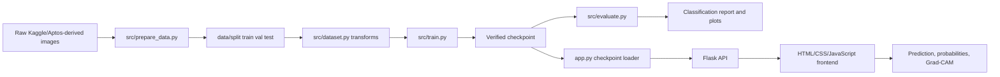
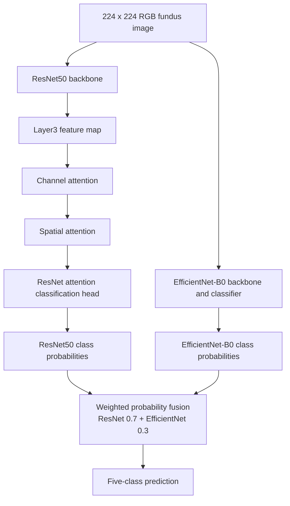
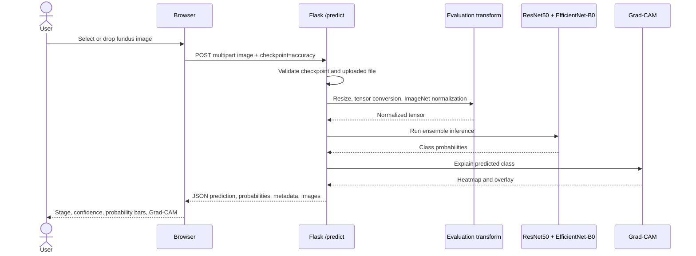
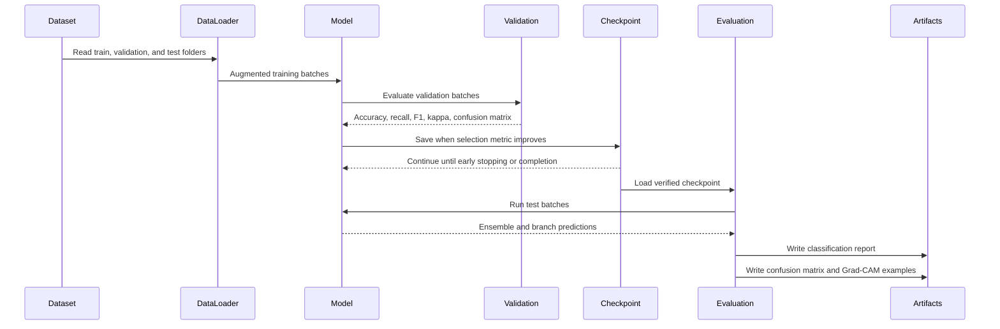
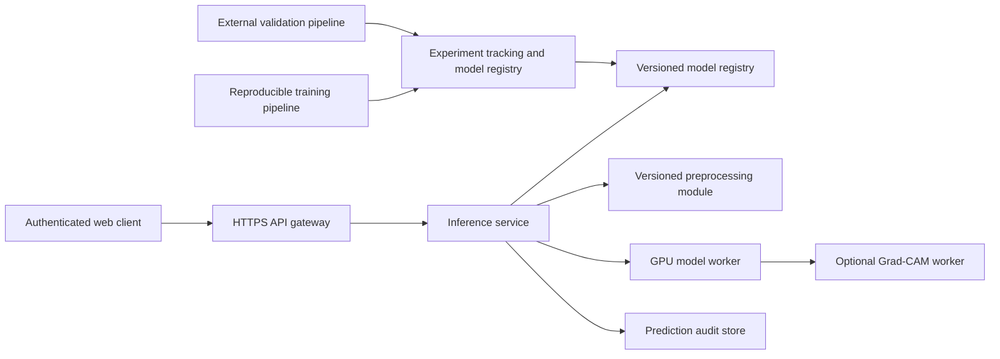

# System Architecture: Explainable Diabetic Retinopathy Classification

## 1. System Overview

This project is an end-to-end research prototype for five-class diabetic retinopathy (DR) classification from retinal fundus images. It combines a dual-attention ResNet50 branch with an EfficientNet-B0 branch, fuses their class probabilities, generates a Grad-CAM visual explanation, and exposes the result through a Flask web application with an HTML/CSS/JavaScript frontend.

The system supports two related execution paths:

1. **Offline training and evaluation**: dataset preparation, stratified splitting, augmentation, training, checkpoint selection, held-out evaluation, confusion-matrix generation, and Grad-CAM example generation.
2. **Runtime inference**: Flask startup loads the verified recovered checkpoint, accepts an uploaded image, performs deterministic preprocessing, predicts the DR class, generates Grad-CAM, and returns JSON to the browser.

The verified runtime checkpoint is `checkpoints/best_model_accuracy_RECOVERED.pth`. Its checkpoint metadata reports validation accuracy of **83.70%** and validation weighted kappa of **0.8780**. Regenerated held-out evaluation on 553 test images reports **86.62% test accuracy**. These are different evaluation stages and must not be conflated.

The system is a research and screening-support prototype. It is not a certified clinical diagnostic device and has not undergone external clinical validation.

## 2. Repository Structure

| Area | Path | Role |
| --- | --- | --- |
| Flask entry point | `app.py` | Loads the runtime checkpoint and serves API routes and frontend pages |
| Model definition | `src/model.py` | Defines attention blocks, ResNet50 branch, EfficientNet-B0 branch, and ensemble fusion |
| Dataset utilities | `src/dataset.py` | Defines class order, transforms, dataset loading, and dataloaders |
| Dataset splitter | `src/prepare_data.py` | Creates stratified train/validation/test folder splits |
| Training | `src/train.py` | Trains, validates, selects checkpoints, evaluates test data, and writes history |
| Fast training | `src/fast_train.py` | Legacy/alternative feature-cached training path |
| Evaluation | `src/evaluate.py` | Evaluates a checkpoint and writes classification, confusion-matrix, and Grad-CAM artifacts |
| Explainability | `src/gradcam.py` | Generates Grad-CAM heatmaps and overlays |
| Loss functions | `src/losses.py` | Provides objective and class-weight utilities |
| Frontend template | `templates/index.html` | Defines upload, checkpoint, result, and visualization UI |
| Frontend logic | `static/script.js` | Calls Flask endpoints and renders prediction results |
| Frontend styles | `static/style.css` | Defines the visual layout and responsive styling |
| Checkpoints | `checkpoints/` | Stores model state dictionaries and validation metadata |
| Generated outputs | `outputs/` | Stores evaluation reports, plots, and training artifacts |

## 3. Layered Architecture

### 3.1 Data layer

The source dataset is expected by `src/prepare_data.py` under `data/raw/gaussian_filtered_images/<class>`. The project uses five canonical folder labels:

- `No_DR`
- `Mild`
- `Moderate`
- `Severe`
- `Proliferate_DR`

The current split is stored under `data/split/train`, `data/split/val`, and `data/split/test`, with one class folder under each split.

The verified distribution is:

| Class | Train | Validation | Test |
| --- | ---: | ---: | ---: |
| No DR | 1,263 | 270 | 272 |
| Mild | 259 | 55 | 56 |
| Moderate | 699 | 149 | 151 |
| Severe | 135 | 28 | 30 |
| Proliferative DR | 206 | 44 | 44 |
| **Total** | **2,562** | **546** | **553** |

### 3.2 Preprocessing layer

`src/dataset.py` defines the preprocessing boundary.

Training preprocessing includes:

- Resize to 224 x 224
- Random horizontal flip
- Random vertical flip
- Random rotation
- Random resized crop
- Brightness, contrast, saturation, and hue jitter
- Optional aggressive minority augmentation, including elastic transform and random erasing
- Conversion to tensor
- ImageNet normalization

Evaluation preprocessing includes only resize, tensor conversion, and ImageNet normalization. The Flask application uses `get_eval_transforms()` for uploaded images.

### 3.3 Training layer

`src/train.py` builds dataloaders, constructs the ensemble, trains with AdamW, uses `ReduceLROnPlateau`, clips gradients, evaluates validation metrics, applies early stopping, and saves checkpoint metadata with the model weights.

The code supports accuracy, weighted cross-entropy, and ordinal objectives. It also supports restricted mixup and a second focus stage for Moderate, Severe, and Proliferative DR. The verified recovered checkpoint was loaded successfully by the app and identifies itself as an ensemble checkpoint selected by validation accuracy at epoch 21.

### 3.4 Model inference layer

`src/model.py` defines:

- `ChannelAttention`: squeeze-and-excitation style channel recalibration
- `SpatialAttention`: 1 x 1 convolution followed by spatial softmax and feature reweighting
- `DualAttention`: sequential channel then spatial attention
- `DualAttentionResNet50`: ResNet50 feature extractor and classification head
- `ResNetEfficientNetEnsemble`: weighted class-probability fusion

For a 224 x 224 input, the verified checkpoint uses ResNet `layer3` as the feature layer. The ResNet50 branch contributes 0.7 of the ensemble probability and EfficientNet-B0 contributes 0.3.

### 3.5 Explainability layer

`src/gradcam.py` attaches hooks to the ResNet attention-enhanced classification feature path, specifically the `head_conv` target layer. It computes gradients for the selected class, creates a normalized heatmap, resizes it to 224 x 224, and overlays it on the original RGB image.

### 3.6 Evaluation layer

`src/evaluate.py` loads a checkpoint, evaluates the test dataloader, compares ensemble and branch predictions, writes `outputs/classification_report.json`, and generates:

- `outputs/confusion_matrix.png`
- `outputs/gradcam_examples.png`

The verified current classification report contains the following held-out results:

| Metric | Result |
| --- | ---: |
| Accuracy | **86.62%** |
| Macro precision | **77.07%** |
| Macro recall | **71.45%** |
| Macro F1-score | **73.43%** |
| Weighted precision | **85.98%** |
| Weighted recall | **86.62%** |
| Weighted F1-score | **86.01%** |
| Test support | **553** |

### 3.7 Flask API layer

`app.py` creates the Flask server, loads the verified checkpoint at import/startup, owns the global model and Grad-CAM instances, and provides health, sample, and prediction routes.

At startup, the app validates that the selected checkpoint exists and that its `model_type` is `resnet50_efficientnet_b0_ensemble`. It refuses to silently load an untrained fallback model.

### 3.8 Frontend presentation layer

`templates/index.html` renders the upload control, checkpoint selector, result area, class probability bars, source image, and Grad-CAM image. `static/script.js` performs the health check, builds `FormData`, sends the image to `/predict`, validates the JSON response, and renders prediction fields and images.

The current UI defaults to the verified `accuracy` checkpoint. The unavailable kappa checkpoint is no longer offered in the dropdown.

### 3.9 Checkpoint and artifact storage layer

Checkpoints contain model weights and metadata such as model type, objective, selection metric, epoch, validation metrics, feature layer, and ResNet ensemble weight. Generated JSON and image artifacts are stored under `outputs/`.

## 4. Component Inventory

| Component | Source | Inputs | Outputs | Dependencies | Failure modes |
| --- | --- | --- | --- | --- | --- |
| Dataset splitter | `src/prepare_data.py` | Raw class folders, split ratios, seed | `data/split/*`, `split_stats.json` | Python filesystem APIs | Missing raw class folder, invalid ratios, copy failure |
| Dataset loader | `src/dataset.py` | Split directory and transform options | PyTorch datasets and dataloaders | PyTorch, torchvision, PIL, NumPy | Missing folders, no image files, unreadable image |
| Train transforms | `src/dataset.py` | PIL image | Augmented normalized tensor | torchvision transforms | Invalid image or transform configuration |
| Eval transforms | `src/dataset.py` | PIL image | Deterministic normalized tensor | torchvision transforms | Invalid image |
| Attention blocks | `src/model.py` | Feature map | Channel/spatially reweighted feature map | PyTorch | Invalid feature-layer channel count |
| ResNet50 branch | `src/model.py` | 3 x 224 x 224 tensor | Five-class logits | torchvision ResNet50 | Missing/incompatible weights or state dict |
| EfficientNet-B0 branch | `src/model.py` | 3 x 224 x 224 tensor | Five-class logits | torchvision EfficientNet-B0 | Missing/incompatible weights or state dict |
| Ensemble fusion | `src/model.py` | Branch probabilities | Log ensemble probabilities | PyTorch softmax/log | Invalid ensemble weight or numerical issues |
| Training loop | `src/train.py` | Dataloaders and arguments | Checkpoint, history, plots | PyTorch optimizer/scheduler, sklearn | OOM, missing data, invalid objective, failed save |
| Test evaluator | `src/evaluate.py` | Checkpoint and test split | JSON report and plots | sklearn, matplotlib, seaborn, PIL | Wrong checkpoint, missing split, plotting failure |
| Grad-CAM | `src/gradcam.py` | Model, input tensor, class index | Heatmap and overlay | PyTorch, OpenCV, PIL, NumPy | Missing hooks, gradient failure, invalid image |
| Checkpoint loader | `app.py` | Checkpoint name | Loaded model and metadata | PyTorch, model factory | Missing file, unsupported model type, incompatible state dict |
| `/health` route | `app.py` | None | Runtime status JSON | Flask | App not running or startup load failure |
| `/sample/<class>` route | `app.py` | Canonical class name | Base64 test image JSON | Flask, PIL, filesystem | Unknown class, missing directory, empty class folder |
| `/predict` route | `app.py` | Multipart image and checkpoint name | Prediction JSON and Grad-CAM | Flask, PIL, PyTorch, Grad-CAM | Missing image, invalid image, invalid checkpoint |
| Browser client | `static/script.js` | Selected local image | Rendered prediction UI | Browser Fetch/FormData APIs | Network error, non-JSON response, malformed payload |

## 5. Data-Flow Diagram



## 6. Model Architecture Diagram



## 7. Runtime Prediction Sequence



## 8. Training and Evaluation Sequence



## 9. Storage and Artifact Map

### Dataset folders

- `data/split/train/No_DR`, `Mild`, `Moderate`, `Severe`, `Proliferate_DR`
- `data/split/val/No_DR`, `Mild`, `Moderate`, `Severe`, `Proliferate_DR`
- `data/split/test/No_DR`, `Mild`, `Moderate`, `Severe`, `Proliferate_DR`
- The raw input location expected by `src/prepare_data.py` is `data/raw/gaussian_filtered_images`.

### Checkpoints currently present

- `checkpoints/best_model_accuracy_RECOVERED.pth`: verified runtime checkpoint; epoch 21; validation accuracy 83.70%; validation weighted kappa 0.8780.
- `checkpoints/best_model_accuracy.pth`: legacy accuracy checkpoint with different metadata and lower validation accuracy; it is not the verified runtime checkpoint.
- `checkpoints/recovery_smoke.pth`: present, but not used by `app.py` and not treated as the reported production-of-record checkpoint.
- `checkpoints/best_model.pth`: absent.
- `checkpoints/best_model_kappa.pth`: absent.

### Evaluation and training artifacts

- `outputs/classification_report.json`: current regenerated held-out report; its accuracy is 0.8661844484629295, or 86.62%.
- `outputs/confusion_matrix.png`: current regenerated test confusion matrix.
- `outputs/gradcam_examples.png`: current regenerated Grad-CAM examples.
- `outputs/training_curves.png`: present, but its provenance should be checked before using it as the verified run history.
- `outputs/metrics_comparison.md`: stale/mixed comparison artifact containing older 67.27%, 68.54%, 69.98%, and 50.09%/related values; it is not aligned with the verified 86.62% report.
- `outputs/model_metrics_stale.json`: stale report with accuracy 0.6726943942133815, or 67.27%.
- `outputs/training_history_stale.json`: stale report with test accuracy 0.6853526220614828, or 68.54%.
- `outputs/model_metrics.json`: absent.
- `outputs/training_history.json`: absent.
- `outputs/conference_code_appendix.pdf`: generated appendix artifact; its metric provenance should be checked before submission.

## 10. API Contract

### `GET /`

Returns the rendered frontend page.

- Request body: none
- Success: HTML from `templates/index.html`
- Failure: standard Flask server error response

### `GET /health`

Returns runtime and checkpoint status.

Example response shape:

```json
{
  "status": "ok",
  "device": "cpu",
  "checkpoint_loaded": true,
  "checkpoint_name": "accuracy",
  "available_checkpoints": {
    "accuracy": true,
    "accuracy_recovered": true,
    "kappa": false
  },
  "model_accuracy": 0.836996336996337,
  "model_weighted_kappa": 0.8779904150512767,
  "metrics_source": "checkpoint validation metrics",
  "branch_accuracies": {
    "resnet50": 0.8333333333333334,
    "efficientnet_b0": 0.7564102564102564,
    "ensemble": 0.836996336996337
  }
}
```

The health response exposes checkpoint validation metrics, not the regenerated held-out test accuracy.

### `GET /sample/<class>`

Returns a random test image for a canonical class.

- Valid class values: `No_DR`, `Mild`, `Moderate`, `Severe`, `Proliferate_DR`
- Success response:

```json
{
  "filename": "example.png",
  "class": "No_DR",
  "image_b64": "<base64 PNG>"
}
```

- Error responses:
  - `400` for an unknown class
  - `404` when the class folder or image files are unavailable

### `POST /predict`

Accepts a multipart form upload.

- Form field `image`: uploaded image file; required
- Form field `checkpoint`: checkpoint key; the current UI sends `accuracy`
- Supported configured keys: `accuracy`, `accuracy_recovered`, and `kappa` in code, although `kappa` currently points to a missing file

Success response fields include:

```json
{
  "predicted_class_index": 0,
  "predicted_label": "0 - No DR",
  "description": "No visible signs of diabetic retinopathy detected.",
  "confidence": 100.0,
  "model_accuracy": 83.7,
  "model_weighted_kappa": 0.878,
  "metrics_source": "checkpoint validation metrics",
  "checkpoint_name": "accuracy",
  "branch_accuracies": {},
  "ensemble": "ResNet50 + EfficientNet-B0",
  "class_probabilities": [],
  "input_image_b64": "<base64 PNG>",
  "gradcam_image_b64": "<base64 PNG>",
  "checkpoint_loaded": true
}
```

The actual response populates `branch_accuracies` and `class_probabilities`; they are abbreviated above.

- Error responses:
  - `400` when the `image` field is missing
  - `400` when the uploaded file is not readable as an image
  - `400`/server error behavior can occur for an unsupported or missing checkpoint because `load_model()` raises an exception

## 11. Security and Reliability Review

### Missing-file behavior

`DRDataset` raises a runtime error when no images are found. `prepare_data.py` raises `FileNotFoundError` when a raw class folder is missing. The Flask sample route returns 404 when the requested class directory is unavailable.

### Invalid-image handling

The `/predict` route catches PIL image-open failures and returns a JSON error with HTTP 400. The browser accepts any MIME type through the file picker, so server-side decoding remains the effective validation boundary.

### Missing-checkpoint behavior

`app.py` explicitly raises `FileNotFoundError` if the selected checkpoint is absent. This prevents silent fallback to an untrained model. However, the resulting exception can become an HTML 500 response unless an application-level error handler is added.

### Unsupported checkpoint behavior

The loader rejects checkpoint metadata whose `model_type` is not `resnet50_efficientnet_b0_ensemble`. It also relies on `model.load_state_dict()`, which will fail for incompatible state dictionaries.

### Input validation

The application validates the presence and decodability of the uploaded image and validates configured checkpoint keys. It does not enforce file size limits, image dimensions before decoding, upload rate limits, authentication, authorization, or content scanning.

### Medical safety limitations

The model output is a research prediction and should not be presented as a diagnosis. Confidence is a model probability, not a clinical certainty. The fixed public dataset, class imbalance, limited Severe support, unknown label noise, and lack of external clinical validation limit deployment claims.

### Model version traceability

The verified checkpoint stores model type, selection metric, epoch, feature layer, ResNet weight, and validation metrics. The API exposes the checkpoint name and validation metrics. A stronger production trace would also expose a cryptographic checkpoint hash, source-code revision, dataset version, preprocessing version, and training configuration.

### Stale artifact risk

This repository contains stale and mixed metrics artifacts:

| Artifact | Observed issue |
| --- | --- |
| `outputs/model_metrics_stale.json` | Reports 67.27% accuracy, not 86.62% |
| `outputs/training_history_stale.json` | Reports 68.54% test accuracy, not 86.62% |
| `outputs/metrics_comparison.md` | Contains multiple older runs, including 67.27% and 68.54%/69.98% values |
| `outputs/classification_report.json` | Matches the verified 86.62% held-out test run |
| `outputs/model_metrics.json` | Missing |
| `outputs/training_history.json` | Missing |

These files must be labelled or removed before conference submission to prevent metric mixing.

### Development-server exposure

`app.py` starts Flask with `host="0.0.0.0"`, which exposes the development server on all interfaces. This is appropriate only for controlled local demonstration. Production deployment requires a production WSGI server, access control, TLS termination, request limits, structured logging, and a controlled model-serving process.

### Remaining source inconsistencies

The following outdated or potentially misleading references remain in source code and should be addressed separately:

1. `src/evaluate.py` documents and defaults to `checkpoints/best_model.pth`, which is absent. Evaluating without an explicit `--checkpoint` therefore targets a missing legacy filename.
2. `src/train.py` documents and defaults to `checkpoints/best_model.pth` and can write `checkpoints/best_model.pth` during its focus stage. This is a legacy training path and does not identify the recovered checkpoint used by the app.
3. `src/fast_train.py` saves and evaluates `checkpoints/best_model.pth`, so it is not aligned with the verified recovered checkpoint naming convention.
4. `app.py` retains a `kappa` entry pointing to `checkpoints/best_model_kappa.pth`, but that file is absent. The current UI does not expose it, but the API key remains configured.
5. The old `checkpoints/best_model_accuracy.pth` exists and is not equivalent to `best_model_accuracy_RECOVERED.pth`; it must not be used interchangeably.
6. The frontend labels `model_accuracy` as an ensemble test accuracy in `static/script.js`, but the API supplies checkpoint validation accuracy and labels its source as `checkpoint validation metrics`. This display text is semantically misleading even though the numeric value is correctly loaded from the checkpoint.

## 12. Architecture Quality Assessment

### Strengths

- Clear separation between dataset, model, training, evaluation, explainability, API, and frontend modules.
- Stratified folder-based split preserves class representation across partitions.
- Deterministic evaluation preprocessing is shared by evaluation and runtime inference.
- The ensemble combines complementary ResNet50 and EfficientNet-B0 representations.
- Dual channel/spatial attention provides an explicit lesion-focused feature mechanism.
- Grad-CAM is connected to the classification feature path rather than being a disconnected visualization.
- The recovered checkpoint is validated before use and is not silently replaced with an untrained model.
- The frontend now uses the available verified accuracy checkpoint by default.

### Weaknesses

- The repository contains multiple checkpoint naming conventions and stale metric artifacts.
- Training and evaluation defaults still target absent legacy checkpoint names.
- The Flask process keeps the model and Grad-CAM state in module globals, which limits worker and concurrency design options.
- The API does not expose a model hash or test-report version.
- The development server is exposed on all interfaces.
- The evaluation script writes reports but does not include checkpoint identity and hash in the JSON report.
- There is no automated test proving that the app checkpoint, evaluation checkpoint, and displayed metrics are identical.

### Bottlenecks

- CPU inference is expensive because both backbones execute and Grad-CAM requires an additional gradient pass.
- Grad-CAM and base64 image encoding increase prediction latency and response size.
- Test evaluation requires loading both branches and generating image plots.
- Dataset image loading and augmentation are filesystem-bound when running without workers or GPU acceleration.

### Reproducibility risks

- Checkpoint and artifact provenance is not uniformly recorded.
- Random augmentation, dataloader order, model initialization, and training configuration require explicit seed capture for exact reproduction.
- Existing stale artifacts make it easy to cite a metric from a different run.
- The current report does not include a checkpoint digest or complete command line.

### Maintainability risks

- Legacy `best_model.pth` and `best_model_kappa.pth` paths remain in active training/evaluation code.
- The app and frontend use validation metadata but UI text can describe it as test accuracy.
- The API contract is implicit in Python dictionaries rather than a schema.
- There is duplicated responsibility between full training and fast training paths.

### Scalability limitations

- The Flask development server is not a production serving architecture.
- Each prediction performs a synchronous Grad-CAM computation.
- Images are transferred as base64 inside JSON, increasing payload size.
- There is no queue, batching service, model cache across worker processes, or observability pipeline.

## 13. Recommended Improvements

1. Make `best_model_accuracy_RECOVERED.pth` the single explicit evaluation and runtime checkpoint reference, or introduce a versioned checkpoint manifest.
2. Update `src/evaluate.py`, `src/train.py`, and `src/fast_train.py` so defaults cannot silently target absent legacy files.
3. Remove or clearly quarantine stale metrics and add checkpoint identity, SHA-256 hash, dataset split hash, and command-line configuration to every generated report.
4. Rename API fields to distinguish `validation_accuracy` from `test_accuracy`, or add both fields with explicit sources.
5. Add automated tests that compare the checkpoint loaded by Flask with the checkpoint used by evaluation and verify expected metadata.
6. Add upload size limits, content-type validation, rate limiting, and structured exception handlers.
7. Replace the Flask development server with Gunicorn or another production WSGI server behind a reverse proxy for deployment.
8. Store Grad-CAM images separately or provide an optional explanation flag to reduce latency when explanations are not needed.
9. Add external validation, calibration analysis, confidence intervals, and controlled attention/ensemble ablation studies.

## 14. Recommended Target Architecture

A future production-oriented architecture should separate concerns into versioned services:



The target system should include a versioned model registry, immutable evaluation reports, a production WSGI/ASGI serving layer, request validation and authentication, structured monitoring, audit logging, external validation datasets, and explicit separation between research metrics and clinical performance claims.
